<h1 align="center">🏆 Дипломы и сертификаты</h1>

  <a href="README.md">← Назад к профилю</a>

Здесь собраны сканы и фото моих наград, сертификатов и курсов. Сначала олимпиады и конкурсы, потом обучение.

## Содержание

- [Олимпиады и конкурсы](#-олимпиады-и-конкурсы)
- [Обучение и курсы](#-обучение-и-курсы)

---

## 🥇 Олимпиады и конкурсы

### 2024 · Национальная технологическая олимпиада: диплом призёра

Заключительный этап, профиль «Технологическое мейкерство», команда «Dream Team». Проект: прототип устройства для анализа вещества.

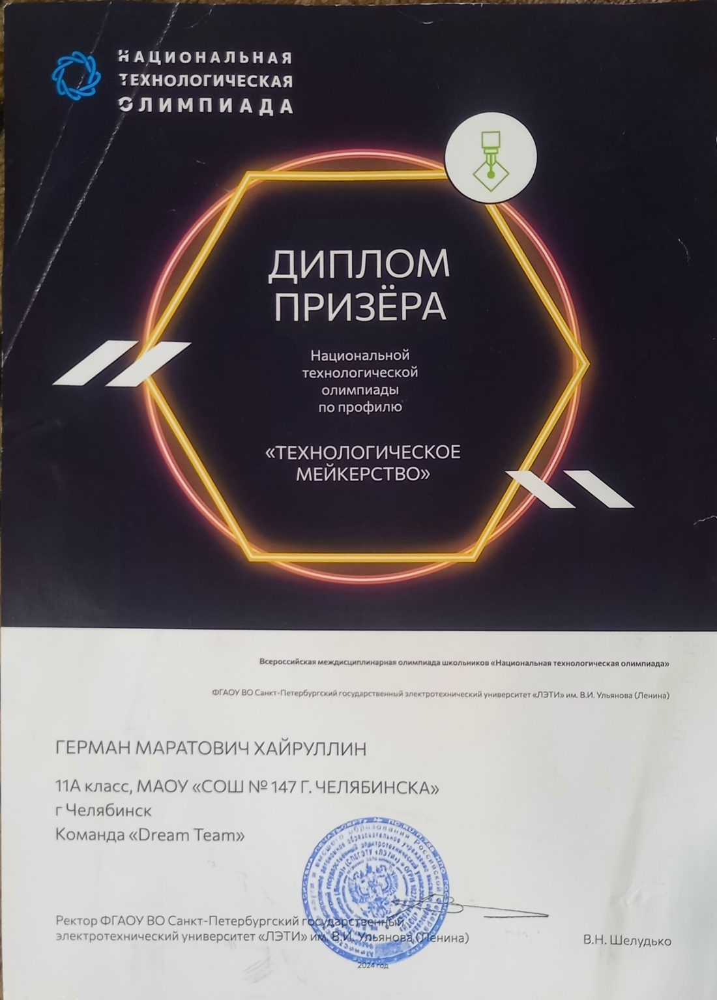

### 2024 · «Талант НТО»: диплом победителя

Конкурс цифровых портфолио, компетенция «Инженерия».

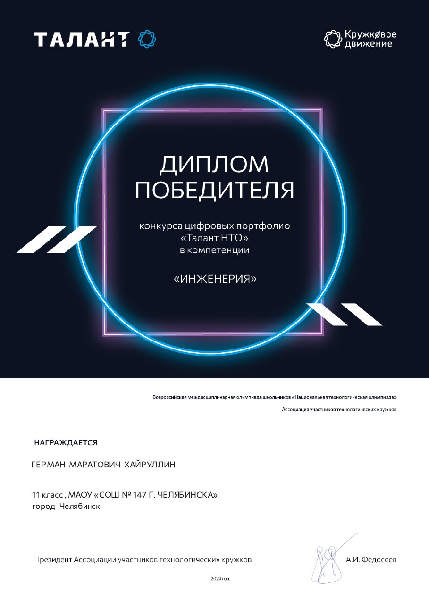

### 2023 · «Стратосферный спутник»: призёр II степени

Всероссийская научно-исследовательская программа для школьников и студентов (Роскосмос, «Воздушно-инженерная школа»), лига «Стратонавт-кандидат». Команда «Инсектоспутники», проект [InsectoSputnik](https://github.com/Fompi06/InsectoSputnik).

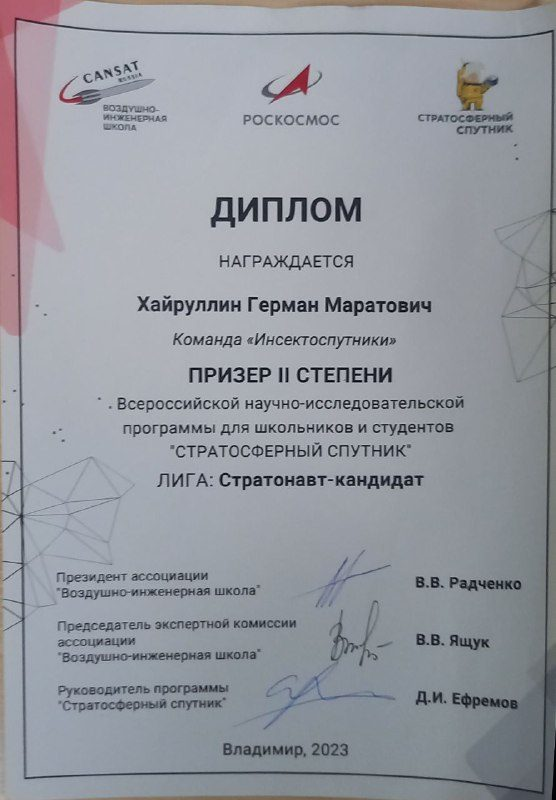

### 2023 · Олимпиада «Технологическое предпринимательство»: призёр отборочного этапа

Профиль «Информационные технологии».

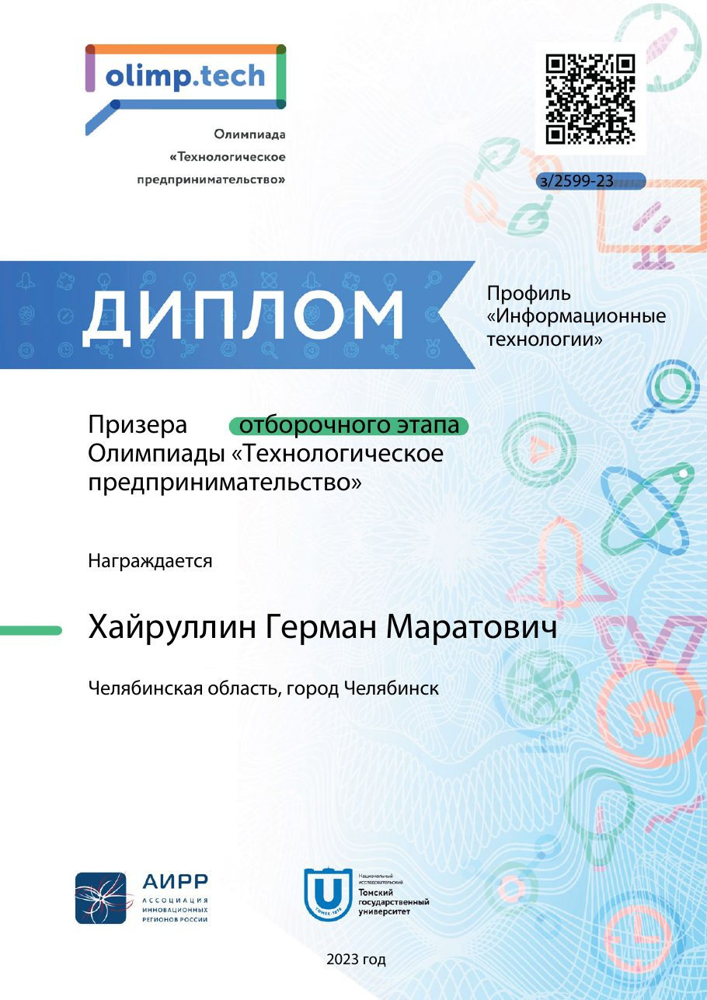

### 2023 · Космический чемпионат: участник

Международный аэрокосмический фестиваль, 30 ноября – 5 декабря 2023 г.

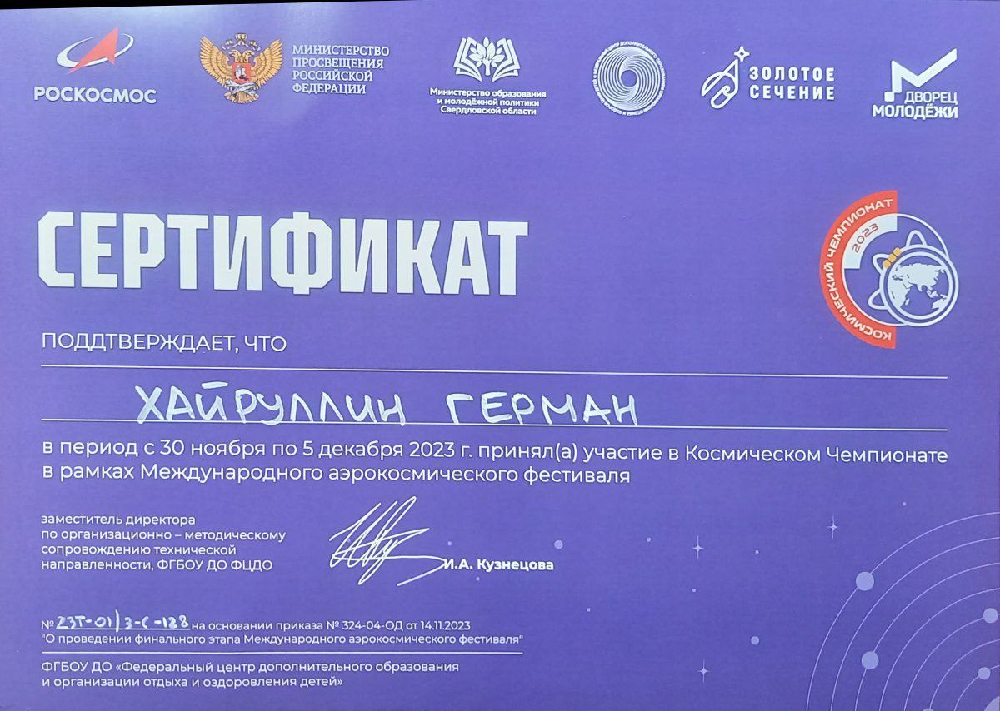

---

## 🎓 Обучение и курсы

### Школа ведущих, звука и света (ШВЗИС), Студенческий союз МИРЭА

Сертификат за успешное прохождение программы.

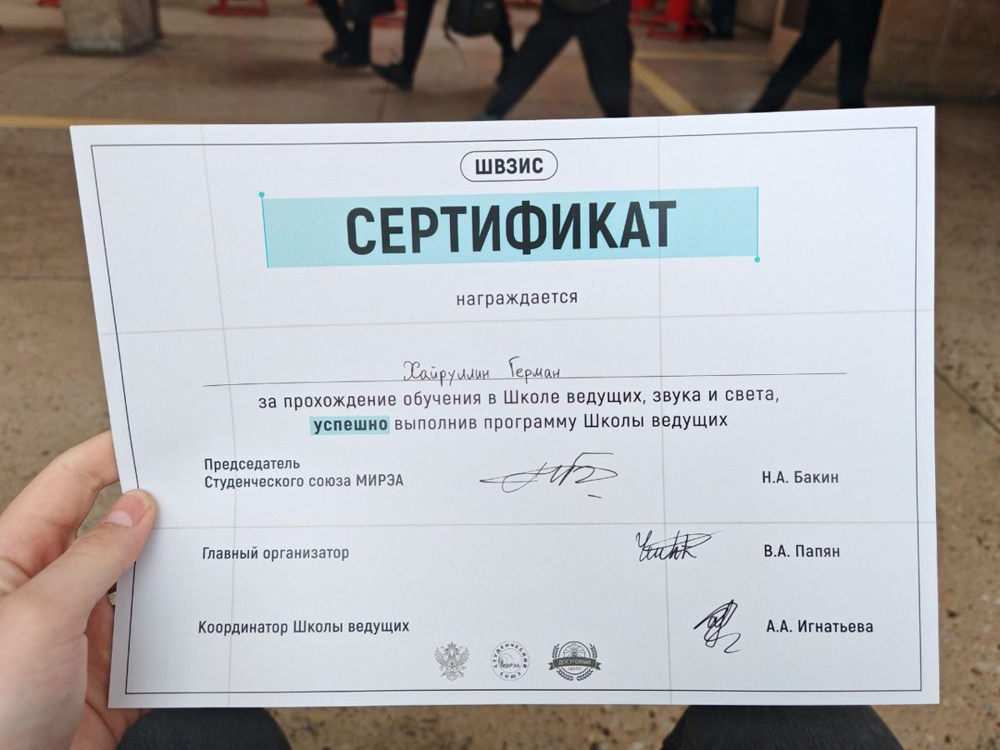

### 2023 · Проектирование и программирование фемтоспутников

Курчатов-центр, 70 часов (27.05.2023 – 09.06.2023).

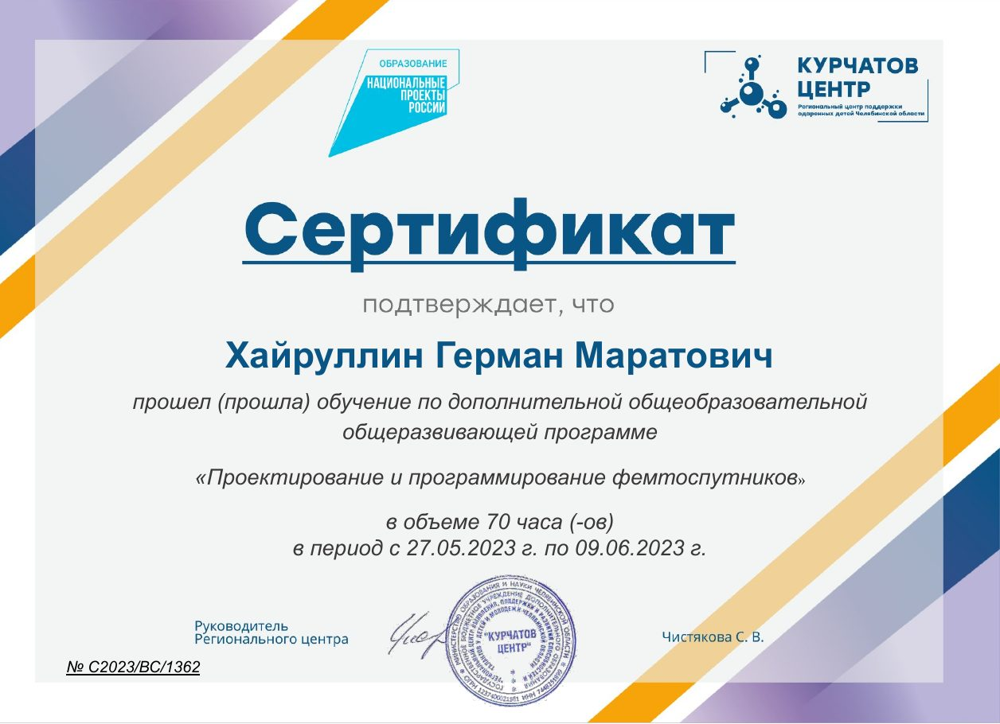

### 2023 · Основы инженерно-технологического моделирования и прототипирования

Курчатов-центр, 52 часа (29.09.2023 – 08.10.2023).

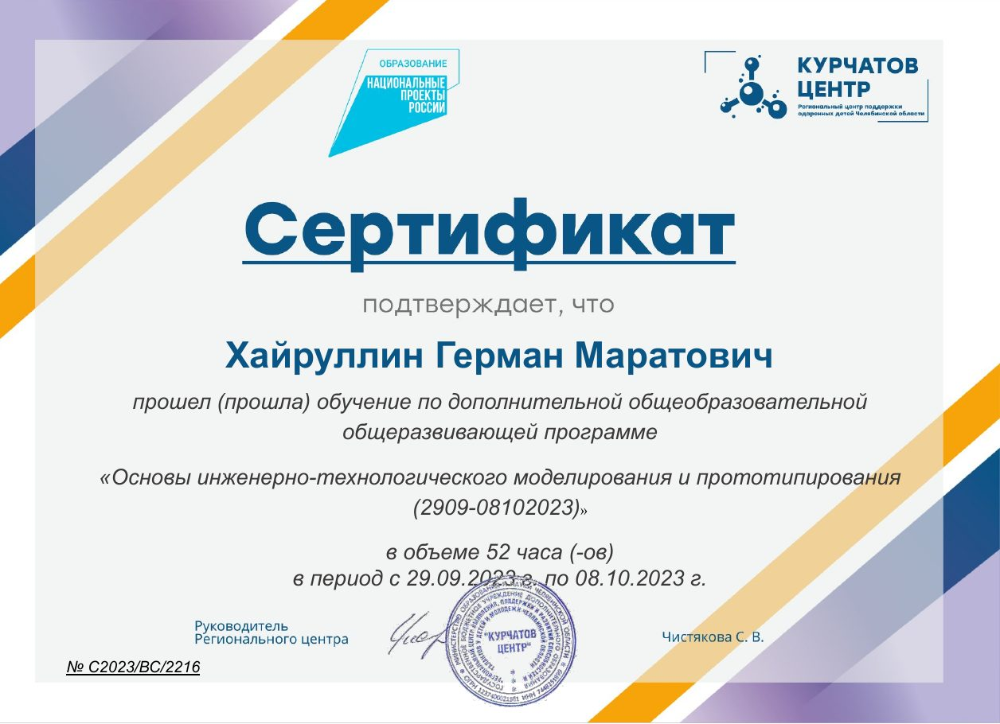

### 2023 · Умная электроника (продвинутый уровень)

Кванториум, 144 часа.

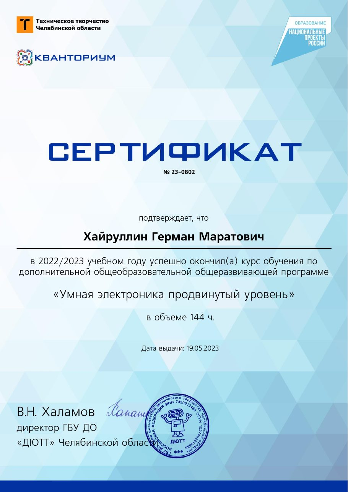

### 2023 · Проектная деятельность

Кванториум, 144 часа.

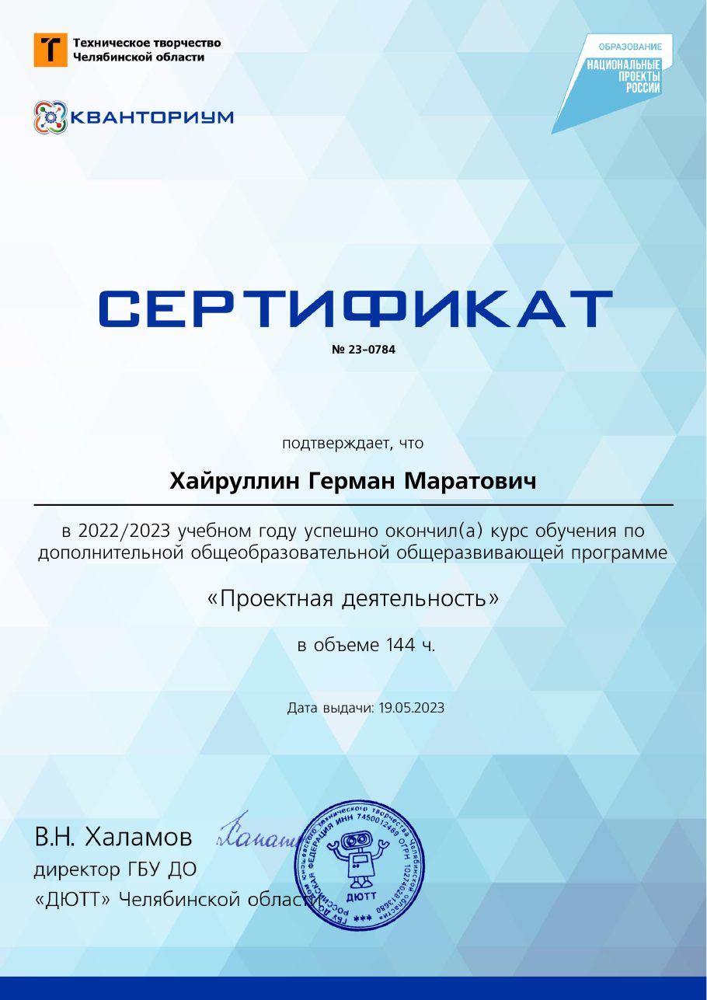

### 2023 · Программирование на C++

«Код будущего», 144 академических часа.

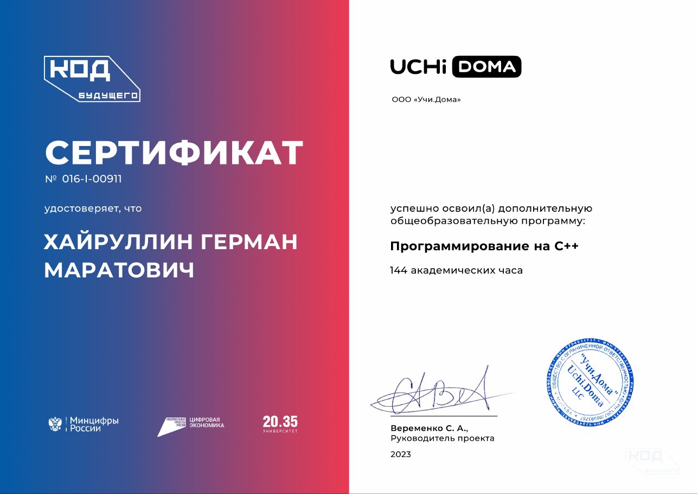

Отдельный сертификат за модуль «Компоненты» этого курса (36 часов, 18.05.2023):

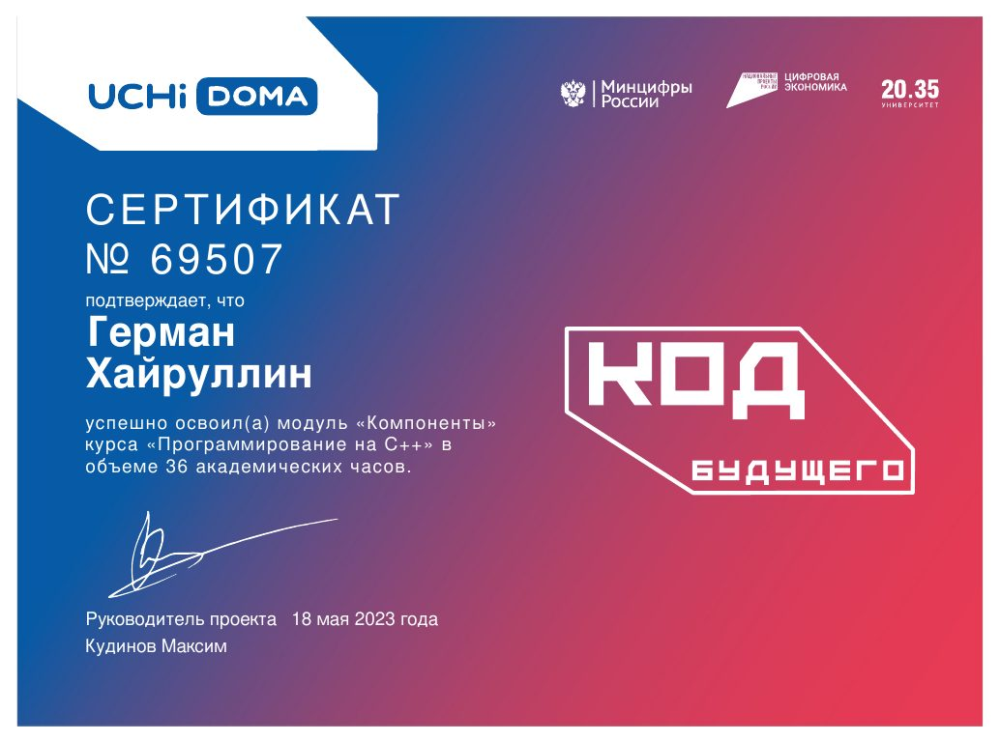

### 2023 · Профессия — Белый Хакер

CyberED / Stepik, 12.08.2023. [Проверить сертификат на Stepik](https://stepik.org/cert/2147974).

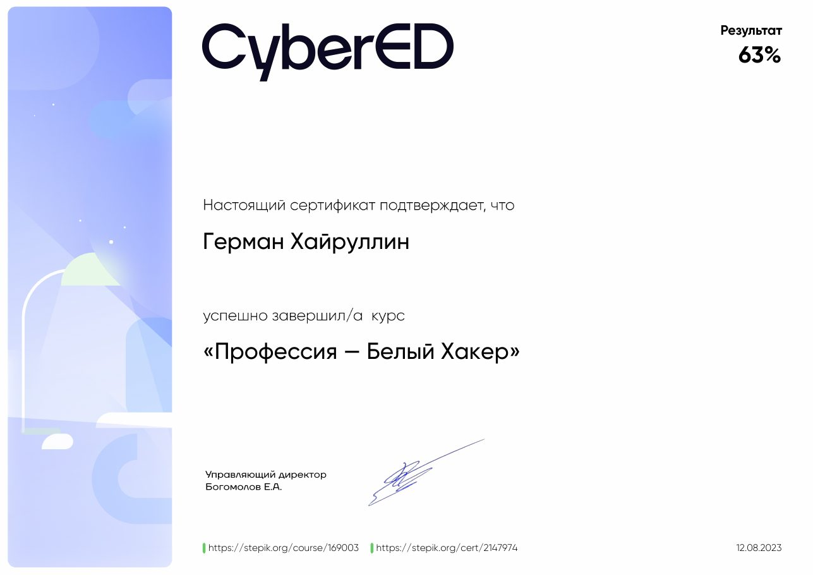

---

  <a href="README.md">← Назад к профилю</a>

